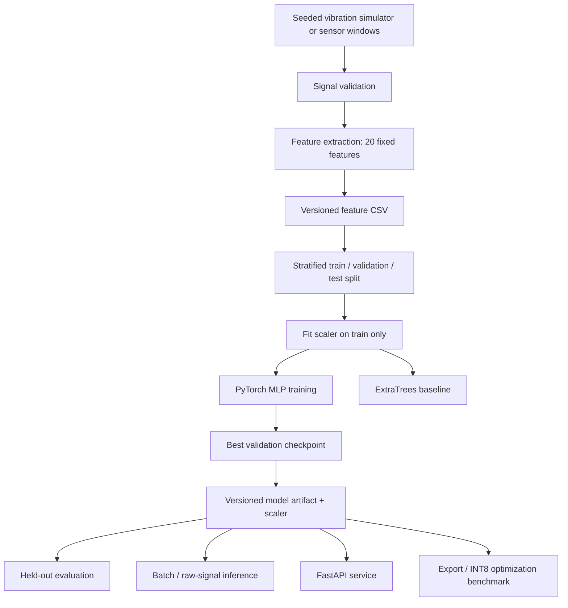

# VibeGuard ML Systems

**An end-to-end, reproducible machine-learning engineering project for motor-vibration fault classification, training, inference, and performance optimization.**

[](https://www.python.org/)
[](https://pytorch.org/)
[](https://pytest.org/)
[](LICENSE)

VibeGuard is a portfolio-grade ML systems repository. It starts with reproducible vibration-signal generation, extracts a fixed numerical feature contract, trains a PyTorch classifier, compares it with a classical machine-learning baseline, validates a versioned model artifact, serves batch and raw-signal predictions, and measures CPU inference trade-offs.

> **Data honesty:** the included data is synthetic and generated by a deterministic signal simulator. The project demonstrates engineering methods and reproducible experiments; its metrics are not evidence of industrial or real-machine accuracy. Validate on correctly labelled sensor data before any operational use.

## Project at a glance

| Area | Implementation |
|---|---|
| Problem | Four-class motor condition classification |
| Classes | Healthy, imbalance, misalignment, bearing fault |
| Signal processing | Time-domain statistics, FFT spectrum, band power, harmonic ratios |
| Feature contract | 20 ordered, versioned, finite-valued features |
| Deep-learning model | Compact PyTorch MLP, GELU, dropout, AdamW, cross-entropy |
| Classical baseline | ExtraTreesClassifier |
| Training controls | Fixed seeds, train-only StandardScaler, stratified splits, validation early stopping, gradient clipping, finite-loss checks |
| Evaluation | Accuracy, macro precision/recall/F1, log loss, per-class metrics, confusion matrix |
| Inference | Batch prediction, raw waveform-to-prediction path, validated FastAPI endpoints |
| Optimization | `torch.export` FP32 export, optional TorchAO INT8 path / PyTorch compatibility fallback, eager-vs-export-vs-INT8 comparison |
| Engineering | CLI, typed modules, tests, Docker, CI, API docs, model card, coding-agent instructions |

## Architecture



The test split is not used for fitting preprocessing, choosing epochs, or selecting checkpoints. The baseline and neural model use the same split so their test metrics can be compared fairly.

## Quick start

### 1. Create an environment

Python 3.11 or newer is recommended. PyTorch installation varies by CPU, CUDA, and platform; install the PyTorch build appropriate for your machine from the [official selector](https://pytorch.org/get-started/locally/), then install this project.

```bash
python -m venv .venv
# macOS / Linux
source .venv/bin/activate
# Windows PowerShell: .venv\Scripts\Activate.ps1

python -m pip install --upgrade pip
python -m pip install -e ".[dev]"
```

Optional modern quantization backend (use a TorchAO version compatible with your PyTorch build):

```bash
python -m pip install -e ".[dev,quantization]"
```

### 2. Generate data and train

```bash
vibeguard generate-data --samples-per-class 1000 --seed 42
vibeguard train --config configs/default.json
```

Training creates:

```text
artifacts/
├── model.pt                    # versioned PyTorch checkpoint + training scaler
├── baseline_extratrees.joblib  # classical baseline
├── training_history.csv        # per-epoch train / validation loss
├── training_summary.json       # run-level summary
├── test_metrics.json           # held-out MLP metrics
└── model_comparison.json       # MLP vs ExtraTrees metrics
```

### 3. Validate and evaluate

```bash
vibeguard validate
vibeguard evaluate
```

`validate` checks the dataset, split integrity and checkpoint schema. `evaluate` independently re-computes the held-out metrics using the deterministic split seed.

### 4. Run inference

Batch prediction from a feature CSV:

```bash
vibeguard predict \
  --input data/motor_vibration.csv \
  --checkpoint artifacts/model.pt \
  --output artifacts/predictions.csv
```

Raw waveform prediction (feature extraction is performed inside the pipeline):

```bash
vibeguard predict-window \
  --input examples/sample_vibration_window.json \
  --checkpoint artifacts/model.pt
```

The raw-window JSON format is:

```json
{
  "sample_rate_hz": 1024,
  "fundamental_hz": 21.0,
  "signal": [0.01, -0.03, 0.08]
}
```

The example file contains a complete 512-sample synthetic waveform. The array above is abbreviated for readability and is not a runnable request by itself. The actual signal list must contain at least 32 finite values.

### 5. Measure inference performance

Quick eager-mode benchmark:

```bash
vibeguard benchmark --runs 250 --warmup 40 --threads 1
```

Run the representation comparison and export optimized artifacts:

```bash
vibeguard optimize --data data/motor_vibration.csv --runs 300 --warmup 40 --threads 1
```

This creates:

```text
artifacts/optimization/
├── model_exported_fp32.pt2   # torch.export package; accepts raw feature vectors
├── model_dynamic_int8.pt     # quantized state artifact; load with the helper below
└── optimization_report.json # p50 / p95 latency, throughput, size, numerical drift
```

All three measured inference paths include the training-fitted standardization step and accept the same raw 20-feature input. The report includes the host, PyTorch version, batch sizes, warm-up/run counts, and (when `--data` is provided) held-out test metrics for all representations. Results are machine-specific; do not copy latency values between machines or claim a speed-up unless the report actually shows one.

Load the dynamic INT8 artifact in Python:

```python
from vibeguard.optimization import load_dynamic_int8_artifact

optimized = load_dynamic_int8_artifact(
    "artifacts/model.pt",
    "artifacts/optimization/model_dynamic_int8.pt",
)
optimized.eval()
```

If TorchAO is installed and supports the selected host/model, VibeGuard uses its `Int8DynamicActivationInt8WeightConfig` v2 workflow. Otherwise, the experiment uses PyTorch's legacy dynamic-quantization compatibility path and records the backend in the report. Recent PyTorch versions deprecate the legacy API, so prefer the optional TorchAO extra for a current quantization environment. Quantized artifacts must be reconstructed with the same backend used at export time. See the [TorchAO quantization API](https://docs.pytorch.org/ao/stable/api_reference/api_ref_quantization.html) and [PyTorch quantization migration note](https://docs.pytorch.org/docs/stable/quantization.html).

### 6. Start the API

```bash
uvicorn vibeguard.service:app --host 0.0.0.0 --port 8000
```

Open `http://127.0.0.1:8000/docs` for interactive OpenAPI documentation.

- `GET /health` — model readiness check.
- `GET /metadata` — ordered feature and class contract.
- `POST /predict` — batch prediction from engineered feature dictionaries.
- `POST /predict-window` — extract features from a raw waveform and predict its class.

Example raw-window request:

```bash
curl -X POST http://127.0.0.1:8000/predict-window \
  -H "Content-Type: application/json" \
  --data-binary @examples/sample_vibration_window.json
```

Set `VIBEGUARD_CHECKPOINT` to serve a different checkpoint. This API is a portfolio/demo service and intentionally has no authentication or rate limiting; do not expose it publicly without adding production controls.

## Real measured-signal benchmark (CWRU)

The original synthetic workflow remains available and explicitly labelled. A separate extension
now supports measured laboratory vibration recordings from the official [CWRU Bearing Data
Center](https://engineering.case.edu/bearingdatacenter/download-data-file). It uses 12 kHz drive-end
recordings for healthy bearings and 0.007-inch seeded inner-race, ball, and outer-race faults.
Original `.mat` files are downloaded when you run the experiment; they are not bundled here.

Install the optional adapter dependencies and run the cross-load protocol:

```bash
python -m pip install -e ".[dev,realdata]"
python -m experiments.cwru_benchmark.prepare
python -m experiments.cwru_benchmark.train
python -m experiments.cwru_benchmark.profile
```

The split is grouped by recording and motor load: train on 0/1 HP, validate on 2 HP, and test on
3 HP. All overlapping windows from a source recording stay within one split, and the scaler is
fit on training recordings only. Outputs include a validation-selected PyTorch model, an ExtraTrees
baseline, held-out load metrics, per-recording results, p50/p95 latency, throughput, a coarse RSS
observation, and a `torch.profiler` trace. See [`experiments/cwru_benchmark/README.md`](experiments/cwru_benchmark/README.md).

**Important status:** this environment cannot download the original binary CWRU files, so the new
adapter and training code are covered by fixture-based tests, but no CWRU model accuracy or
performance result is claimed yet. Run the commands above on a network-enabled machine before
adding measured-data results to a resume. CWRU is measured lab-rig data, not factory field data,
and the held-out-load protocol does not prove cross-machine generalization.

## Hands-on coding-agent evidence

The repository includes instructions for Cursor, Claude Code and GitHub Copilot, plus bounded
engineering tasks and a run-log template. Configuration files alone do not establish personal
agent proficiency. Complete a task, review the diff, run tests, make a commit, and fill
[`docs/AGENT_RUN_LOG_TEMPLATE.md`](docs/AGENT_RUN_LOG_TEMPLATE.md) before claiming hands-on use.
See [`docs/CODING_AGENT_EVIDENCE.md`](docs/CODING_AGENT_EVIDENCE.md).

## Configuration

Edit `configs/default.json` to change the seed, optimizer, learning rate, weight decay, MLP dimensions, dropout, gradient clipping, early-stopping patience, or ExtraTrees estimator count. CLI flags override supported training values in the config.

Example custom training run:

```bash
vibeguard train \
  --config configs/default.json \
  --epochs 60 \
  --batch-size 64 \
  --learning-rate 0.0005 \
  --device cpu \
  --output-dir artifacts/experiment_01
```

## Repository map

```text
.
├── AGENTS.md                       # shared instructions for coding agents
├── CLAUDE.md                       # Claude Code entry point
├── .cursor/rules/                  # Cursor project rules
├── .github/
│   ├── copilot-instructions.md     # GitHub Copilot instructions
│   └── workflows/ci.yml            # test and lint workflow
├── configs/default.json            # reproducible experiment config
├── data/                           # generated feature dataset + data notes
├── examples/                       # raw signal example request
├── docs/                           # architecture, model card, API, benchmark, agent workflow, walkthrough
├── scripts/                        # repeatable local workflows
├── src/vibeguard/                  # library, trainer, CLI, API and optimization
└── tests/                          # data, features, metrics, training, API, export tests
```

## Reference run results (synthetic data; reproducibility example)

The checked-in reference run uses 4,000 generated windows (1,000 per class), seed 42,
with 2,560 training, 640 validation, and 800 held-out test samples. The PyTorch MLP and
ExtraTrees baseline both scored 1.00 accuracy and 1.00 macro-F1 on this simulator's test
split. This deliberately easy synthetic benchmark verifies that the training, validation,
artifact, and evaluation paths work end to end; it must not be interpreted as a real-world
accuracy estimate.

The optimization report was measured on the bundled CPU environment with PyTorch 2.10.0+cpu,
one thread, 40 warm-up iterations and 300 measured iterations per batch size. Median batch
latency (milliseconds) was:

| Batch | Eager FP32 | `torch.export` FP32 | Dynamic INT8 |
|---:|---:|---:|---:|
| 1 | 0.0373 | 0.0727 | 0.0835 |
| 32 | 0.0468 | 0.0875 | 0.0931 |
| 128 | 0.0713 | 0.1112 | 0.1173 |

On this small network and host, eager FP32 was faster. Dynamic INT8 reduced the saved
artifact from 27,632 to 14,105 bytes, but did not improve measured latency. The held-out
test top-class predictions agreed with eager FP32 for both alternatives; INT8's maximum
absolute probability delta on that test set was about 0.0215. These are local measurements,
not guaranteed results on another machine. The complete report is in
[`artifacts/optimization/optimization_report.json`](artifacts/optimization/optimization_report.json).

## Engineering practices demonstrated

- **Reproducibility:** seeds Python, NumPy and PyTorch; fixed config; deterministic data generation; explicit split seed.
- **Leakage control:** scaler is fitted only on training samples; validation loss chooses the best checkpoint; test data is held out.
- **Numerical safety:** input/schema validation, finite loss/probability checks, gradient clipping, safe feature ratios and probability normalization.
- **Artifact safety:** atomic checkpoint writes, schema versioning, strict state-dict loading and `weights_only=True` loading for PyTorch artifacts.
- **Performance work:** warm-up before timing, p50/p95 latency, throughput across batch sizes, model size and probability drift reporting.
- **Service readiness:** health/metadata endpoints, batch validation, raw waveform endpoint, structured errors and OpenAPI docs.
- **Code quality:** unit/integration tests, CI, Docker and a documented coding-agent workflow.

## Testing and quality checks

```bash
python -m pip install -e ".[dev]"
pytest -q
ruff check .
ruff format --check .
```

Or use the Makefile:

```bash
make setup
make test
make demo
make optimize
make api
```

## Limitations and responsible use

1. **Synthetic data only:** the simulator is deliberately illustrative. It does not model every motor, mounting, sensor, sampling rate, load, environment, or fault progression.
2. **Feature engineering is versioned:** train, inference and external clients must use the same ordered feature definitions and physical units.
3. **No deployment guarantee:** CPU timings and quantization accuracy drift vary by hardware and library versions. Benchmark on the actual target.
4. **Not a safety system:** do not connect model output directly to machine shutdown, maintenance scheduling, or other safety-critical actions without domain validation and human oversight.
5. **No confidence calibration claim:** softmax confidence is a model score, not a verified probability of correctness.

See [the model card](docs/MODEL_CARD.md), [benchmark protocol](docs/BENCHMARKING.md), [architecture notes](docs/ARCHITECTURE.md), [coding-agent workflow](docs/AGENT_WORKFLOW.md), and [project walkthrough / interview guide](docs/PROJECT_WALKTHROUGH.md) before extending or presenting results.

## Suggested GitHub description

> Reproducible end-to-end ML systems project for motor-vibration fault classification: PyTorch model training, feature engineering, evaluation, FastAPI inference, and CPU optimization benchmarks with Torch Export and INT8 quantization.

## License

MIT. See [LICENSE](LICENSE).
